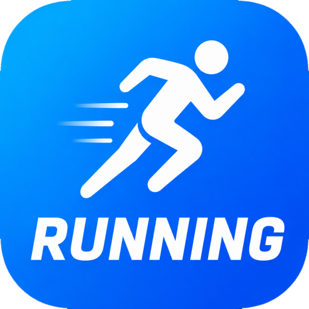

# Running 🏃

Offline Android 8+ running tracker — Adidas Running–style dark UI.
Kotlin · Jetpack Compose · Room · Hilt · MapLibre · Foreground GPS

## Requirements
- Android 8.0 (API 26) and above
- JDK 17, Android Studio Hedgehog+

## Features
- ▶ Live GPS tracking (distance, pace, calories) — works fully offline
- 🛰 Satellite map (Esri) — download region once, view offline forever
- 📋 Run history saved locally (Room)
- 📈 Progress dashboard
- 🎨 Adidas-style UI: black + neon lime

## Build
./gradlew assembleDebug

## GitHub Actions
Push to main → APK artifact auto-build (see .github/workflows/android.yml)

## Policy notes
- Foreground location only (Play policy compliant)
- Privacy policy included (PRIVACY_POLICY.md)
- Google Maps/Satellite tiles are NOT used (ToS prohibits offline caching in 3rd-party apps).
  Satellite imagery © Esri via MapLibre — attribution shown in-app.

## Setup before release
1. In SatelliteMapScreen, pass user's real location as download center
2. Fill Play Console Data Safety form using PRIVACY_POLICY.md
